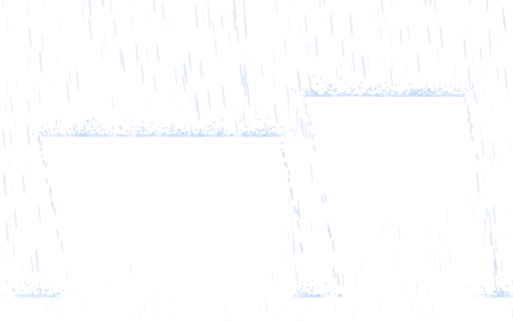
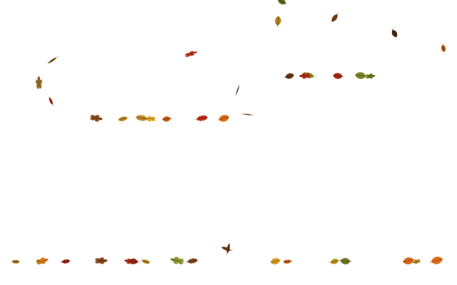
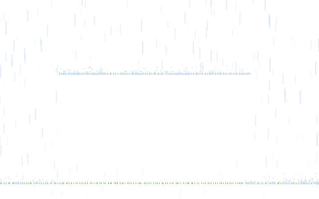
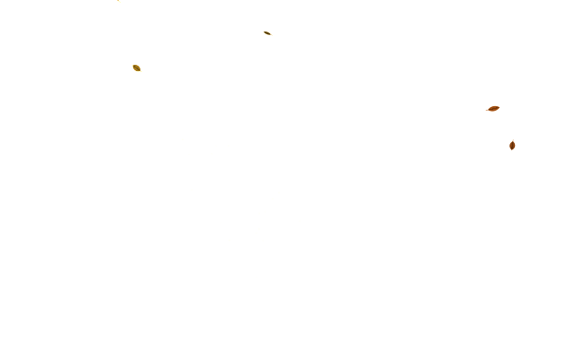

# Sillfall

Animated weather for Windows — rain, snow, fog, leaves, sunlight, and grass that settle on the edges of your open windows. Effects follow window geometry. Clicks pass through.

<p align="center">
  
  
</p>

<p align="center">
  
  
  
</p>

**Status:** Milestone **M14** (release): MSIX for x64 and ARM64, privacy policy, store listing, and winget manifest. Store certification and the name reservation are tracked in [checklist M14](docs/manual-tests/M14.md). See [PLAN.md](PLAN.md).

## Features

- **Six effects** — rain (splashes, puddles, rivulets), snow (accumulation & melt), fog, autumn leaves, sunlight / god-rays, grass on window tops
- **Window-aware** — weather lands on visible edges; closing or shaking a window sheds snow and leaves
- **Click-through** — overlays stay out of the way; optional interactive visitors use separate hit windows
- **Weather sync** — optional live conditions via MET Norway (offline city search, invert, per-effect blend)
- **Scenes** — save and share looks as `.sillscene` files or `sillfall://` links
- **Visitors** — eight original characters that visit window edges; collect them locally
- **Privacy-first** — reads window geometry only; no titles, no screen contents, no analytics
- **English & German** UI, Narrator labels, high contrast, reduced-motion options

## Quick start

Requires the [.NET 10 SDK](https://dotnet.microsoft.com/download). The WinUI app needs **Windows 10 2004** or newer.

```bash
# Full solution (Windows)
dotnet build Sillfall.slnx -p:Platform=x64
dotnet run --project src/Sillfall.App -p:WindowsPackageType=None

# Effect sandbox with fake windows (Windows)
dotnet run --project tools/Sillfall.Sandbox

# Core on Linux (simulation & tests)
dotnet build Sillfall.CrossPlatform.slnf
dotnet test --project tests/Sillfall.Core.Tests
```

## Gallery

| Rain on sills | Snow banks | Grass + rain |
|---|---|---|
|  |  |  |

| Leaves | Fog | Sun & fog |
|---|---|---|
|  |  |  |

These frames are deterministic WARP renders from `tools/Sillfall.FrameDump` (overlay only, transparent background shown as black).

## Architecture (short)

| Project | Role |
|---|---|
| `Sillfall.Core` | Simulation, surfaces, weather mapping, settings (platform-neutral) |
| `Sillfall.Platform` | Win32 overlays, window tracking, tray, shell integration |
| `Sillfall.Render` | Direct3D 11 / DirectComposition / Direct2D |
| `Sillfall.Audio` | XAudio2 |
| `Sillfall.App` | WinUI 3 tray, settings, MSIX packaging |

Product display name and URI scheme come from `AppInfo` (`Sillfall`, `sillfall://`). Assembly / project names still use the historical `Sillfall.*` identifiers until a bulk rename in packaging work.

## Privacy

Sillfall reads **window geometry** only. It does not read titles or contents, does not capture the screen, and ships without telemetry. Crash reports stay on disk under `%LOCALAPPDATA%\Sillfall\logs`. These rules are enforced by automated invariant tests.

## Documentation

- [PLAN.md](PLAN.md) — product plan and milestones
- [CLAUDE.md](CLAUDE.md) — contributor / agent conventions
- [ASSETS.md](ASSETS.md) — source and license for every asset
- [docs/adr](docs/adr) — architecture decisions
- [docs/manual-tests](docs/manual-tests) — Windows checklists
- [docs/weather-mapping.md](docs/weather-mapping.md) — forecast → effect mapping
- [docs/privacy.md](docs/privacy.md) — privacy policy ([Deutsch](docs/privacy.de.md))
- [docs/store/listing.md](docs/store/listing.md) — Microsoft Store listing text
- [winget/](winget) — winget manifest (submitted after the first signed release)

## License

[MIT](LICENSE)
